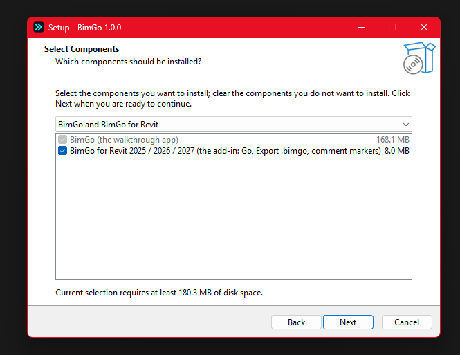
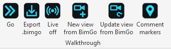
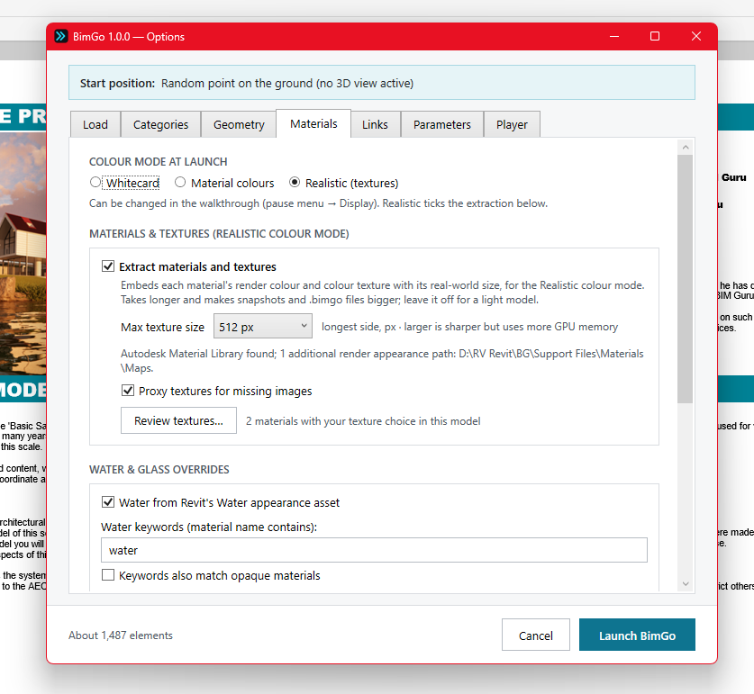
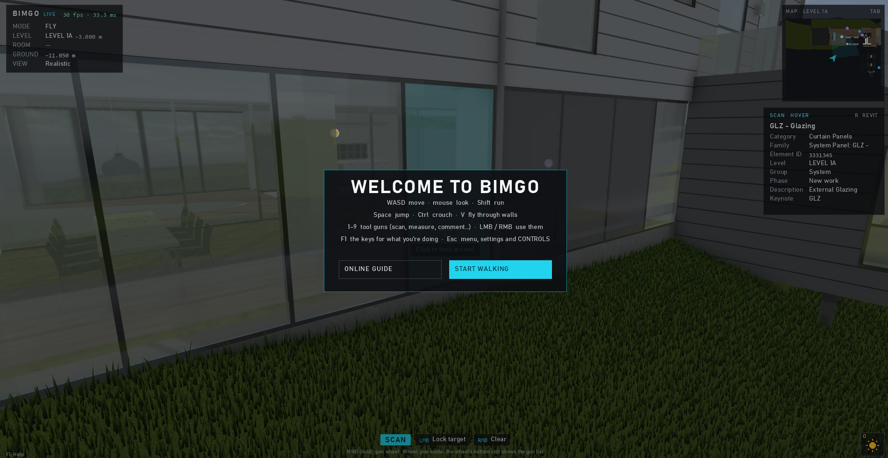

# Getting started

← [Docs home](README.md)

## Install

1. Download `BimGo-Setup-<version>.exe` from the [releases page](https://github.com/aussieBIMguru/BimGo/releases) and run
   it. No admin rights are needed: BimGo installs for your Windows user only.
2. Windows may show "Windows protected your PC" (the setup isn't code-signed yet): choose **More info → Run anyway**.
3. Pick **BimGo and BimGo for Revit** (offered when Revit 2025, 2026 or 2027 is installed), or **BimGo only** to open
   `.bimgo` files without Revit.
4. Close Revit and BimGo first if the setup asks.

The setup installs the app to `%LocalAppData%\Programs\BimGo`, registers `.bimgo` files and adds BimGo to the Start
menu. The first time Revit starts with BimGo for Revit, it may ask whether to load an add-in from an unverified
publisher: choose **Always Load**.

## Your first walkthrough from Revit

1. Open a model in Revit and go to the **BimGo** tab.
2. Click **Go**. The Options window opens: pick the **categories** to load (or *active view only*), the **existing and
   new phases**, any **linked models**, and whether to bring **materials and textures** (Realistic mode).
3. BimGo opens on the model. This is a **live session**: edits you make go straight into Revit, and changes you make
   in Revit offer a refresh (F5).

**Export .bimgo** on the same tab writes a standalone file instead: anyone with BimGo can open it, no Revit needed.

## Opening a file

Double-click a `.bimgo`, drag it (or an `.ifc`) onto the BimGo window, or use **Open** on the start screen. The start screen lists
recent files (with a picture of where you last were) and any live Revit sessions.

## Revit LT and IFC files

Revit LT can't run add-ins, so BimGo for Revit (Go, Export .bimgo) isn't available there. Bring the model in as IFC
instead; the same works for IFC from any other program.

1. In Revit LT: **File → Export → IFC**. The default setup (**IFC2x3 Coordination View 2.0**) works well; **IFC4
   Reference View** does too. Rooms come across as spaces when the export includes them (if they're missing, look for
   the room export option in **Modify Setup**, or export from a plan view); *Export only elements visible in view*
   limits it to a view's content. Avoid *IFC4 Design Transfer View*: its curved surfaces are left out.
2. In BimGo: **Open** on the start screen (pick the `.ifc` or `.ifczip`), or drag the file onto the window, or run
   `BimGo.exe "model.ifc"`. BimGo imports it (Esc cancels) and opens the walkthrough.
3. Walk, comment, measure, take photos as usual. The model isn't saved yet: **Esc → SAVE** writes a `.bimgo` (the IFC
   is never changed), and closing with unsaved comments or edits asks first. Next time, open the `.bimgo`; open the IFC
   again only to take in a newer export (as a fresh model).

What comes across: every element with its IFC GUID, name, type, level and property sets (Scan shows them, and search
sets and colour profiles can use them; Revit's element id appears as *Revit ElementId*), colours and transparency from
the materials, openings cut from walls and slabs, storeys as levels, spaces as rooms (Find room, room data), grids, the
site's latitude and longitude for the sun, and Revit's RPC trees and people (swapped for billboards). Furniture,
fixtures and equipment can be moved; edits stay in the file's journal (they can't be pushed into Revit LT).

The first walkthrough shows a short welcome card with the main keys and asks whether to take the
[tutorial](tutorial.md): about 30 short steps that show you around, doing each thing as you go. **NO THANKS** (or Esc)
starts walking: click in the window to look around. Esc → TUTORIAL brings it back whenever you like.

Next: [Moving around](moving-around.md).
