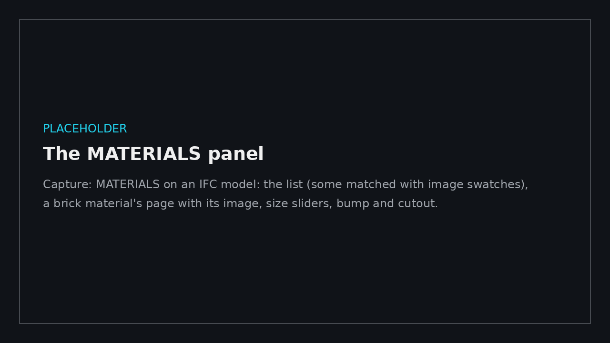

# Materials for IFC models

← [Docs home](README.md)

An IFC export from Revit (and Revit LT, which can only export IFC) carries each material's **name** and **colour**,
but no textures, bump or cutouts. That's how IFC works, and no export setting changes it. BimGo lets you match each
of the model's materials to a proper look instead, and keeps that look inside the `.bimgo`.

## Before exporting from Revit LT

- **Name materials clearly and consistently** ("Brick - Common", "Concrete - Cast-in-Place", "Grass"). Matches,
  suggestions and your material library all go by name.
- In each material's **Graphics** tab, tick **Use Render Appearance**: the exported colour is then close to the real
  one, which is what an unmatched material shows.
- Names with *grass*, *lawn* or *turf* grow grass blades, and see-through ones named *water* ripple, without matching
  anything (the keywords are in Esc → APPEARANCE).
- If colours go missing with IFC4, try exporting IFC2x3 (Coordination View 2.0).

## Matching materials

Open the IFC (or its `.bimgo`), then Esc → **MATERIALS**. It replaces TEXTURES for IFC models.

- **On the left:** every material from the IFC, with a search box and ALL / TO MATCH / MATCHED / OVERRIDES. Each row
  shows its colour (or the image it's matched to) and what it's matched to, or a suggestion from its name.
- **PICK ON MODEL** (the eyedropper): aim at a surface and click, and its material is selected. Esc goes back.
- **On the right:** the selected material's look.
  - **The image:** **BIMGO TEXTURES…** (brick, blockwork, concrete, render, plywood, timber, tiles, marble, stone,
    metal, gravel, grass, asphalt, carpet, fabric…, each at its real size), **AUTODESK LIBRARY…** (the Autodesk
    Material Library that installs with Revit and Revit LT, searched by name, with its bump image when it has one) or
    **YOUR IMAGE…** (any JPEG or PNG). NO IMAGE leaves a plain colour.
  - **Colour:** COLOUR… picks one; IFC COLOUR puts the export's own back.
  - **Image width / height:** how big one repeat of the image is on the real surface, in metres (a brick image of 9 ×
    6 courses is about 2 × 0.5 m). **Turn** rotates it in 15° steps.
  - **Shine** and **Polish** (how sharp the reflection is), **Metal**, **Water**, **Grass blades**.
  - **Bump (relief):** none, FROM THE IMAGE (its light parts stand out), or OWN IMAGE… (a height map: white high,
    black low), with a strength.
  - **Cutout (holes):** none, the IMAGE'S TRANSPARENCY (a PNG with see-through parts) or a MASK IMAGE… (black is a
    hole), with where to cut. Holes let the sun through: perforated metal, mesh fences, leaves.
- Sliders show their change at once and apply it when you let go; everything else applies straight away.
- **SHOWING: MATCHED / IFC COLOURS** (top) switches between your look and the export's own colours, to compare.
- **USE SUGGESTIONS** matches every unmatched material whose name suggests one of BimGo's textures. Check them and set
  each image's real size.

Images, bump and cutouts show in the **Realistic** colour mode. The panel offers to turn it on.

## One element or a whole category

After PICK ON MODEL, the material's page has **OVERRIDE THIS ELEMENT** and **OVERRIDE ITS CATEGORY**. They give that
element (or every wall, floor…) a look of its own, starting from the material's. Use them when the IFC's materials are
generic ("Default") or missing. Overrides are listed under OVERRIDES and edited the same way.

## Your material library

Matches you'll use again belong in your **material library**:

- **SAVE TO MY LIBRARY** (one material) or **SAVE ALL TO LIBRARY** keeps them by name, with their images.
- When an IFC is opened, materials with the same name start matched from the library. **APPLY LIBRARY** does the same
  for a model that's already open.
- **EXPORT LIBRARY…** writes it to a `.bimgo-materials` file; a colleague's **IMPORT LIBRARY…** adds it to theirs.

The library is kept in `%LocalAppData%\BimGo\Material library.bimgo-materials`.

## In the file, and in a viewer copy

The matches, their images and the look they make are saved **inside the `.bimgo`** (Ctrl+S). A **viewer copy**
(SAVE VIEWER COPY…) carries everything too, so the person you send it to needs nothing else, not the library and not
the images. It opens in the Realistic colour mode so the images show.

When the IFC is exported again, **UPDATE FROM IFC** ([Site photos → A newer model](site-photos.md#a-newer-model))
matches the new export by material name. Overrides follow elements by their IFC GlobalId and categories by category.

## Good to know

- Images are stored at up to 1024 px. A PNG with transparency stays a PNG (for cutouts); everything else is stored
  as JPEG.
- The image is laid flat on floors and roofs (seen from above) and runs along walls horizontally, upright. Curved
  surfaces get the same rule, so an image on a curved wall can stretch a little.
- Matching is for IFC models. Models exported from full Revit with materials use TEXTURES instead.
