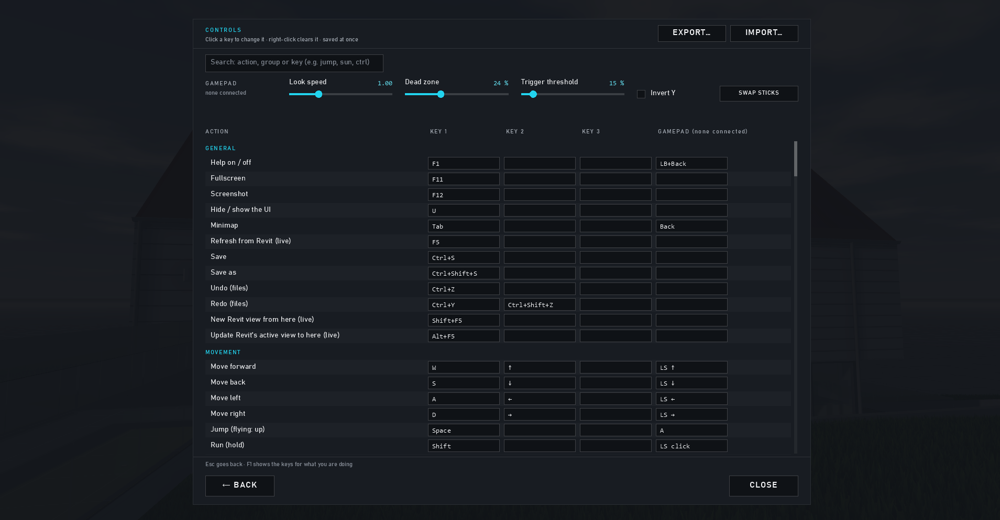

# Settings and files

← [Docs home](README.md)

## Settings

- **Quality profile** (pause menu): Basic, Medium or Realistic; any change of your own shows CUSTOM.
- The menu's tabs: **DISPLAY** (colour mode, anti-aliasing, field of view, mouse, VSync, frame rate limit, ambient
  occlusion, light quality, performance details), **REFLECTIONS**, **APPEARANCE** (water, grass, colour profiles,
  materials), **LIGHTS** (fixture light profiles) and **INTERFACE** (below).
- **INTERFACE**, how BimGo itself looks (the home screen follows):
  - **Theme**: Dark (as BimGo always looked), Light (bright rooms, presentations) or High contrast (projectors, poor
    eyesight). The tools' own colours stay the same.
  - **Accent colour**: eight swatches or OTHER… (any colour) for buttons, highlights and focus.
  - **Interface size** (75–200 %, on top of Windows' display scaling) and **Text size** (90–125 %): applied when the
    slider is let go.
  - **Text font** and **Numbers font**: Inter, Roboto, Source Sans 3 and JetBrains Mono come with BimGo; any font
    installed in Windows can be picked too. Bahnschrift and Consolas are the defaults. Panels are laid out for
    Bahnschrift's width, so a wide font may crowd a label or two.
  - **While walking (HUD)**: **Minimal** (the crosshair, the gun bar and messages; Tab still shows the minimap),
    **Standard** (a compact status: mode, level, room; the gun's panel; the minimap) or **Full** (everything, with the
    ground and colour mode rows and the sun). **Fade the panels while moving** dims them while you walk and brings
    them back a second after you stop.
  - **Tips the first time I use a feature** ([tutorial and tips](tutorial.md)): on by default.
  - **RESET THE INTERFACE** puts it all back (the tips setting stays).
- **Units**: metric or imperial (feet-inches or decimal feet).
- **CONTROLS**: every key and gamepad button (see [Controls](controls.md)).
- In Revit, the **Options** window (opened by Go and Export) holds what is extracted and the player options.

## Where things are kept

| What | Where |
|---|---|
| The app | `%LocalAppData%\Programs\BimGo\` |
| BimGo for Revit | `%AppData%\Autodesk\ApplicationPlugins\BimGo.bundle\` |
| Settings and key bindings | `%AppData%\BimGo\settings.json` |
| Logs | `%LocalAppData%\BimGo\Logs\` |
| A live model's comments, bookmarks, paths, measurements, clashes… | `%LocalAppData%\BimGo\Models\<model>_<id>\` (Options → Player can share them beside the model) |
| A `.bimgo` file's | inside the file |
| Your material library ([materials for IFC models](materials.md)) | `%LocalAppData%\BimGo\Material library.bimgo-materials` |
| Pictures and videos | `Pictures\BimGo`, `Videos\BimGo` |

Uninstalling BimGo always keeps your per-model data, and asks whether to remove settings and logs too.
