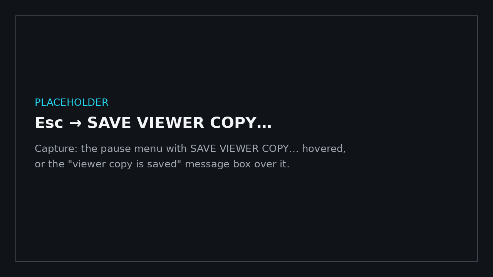
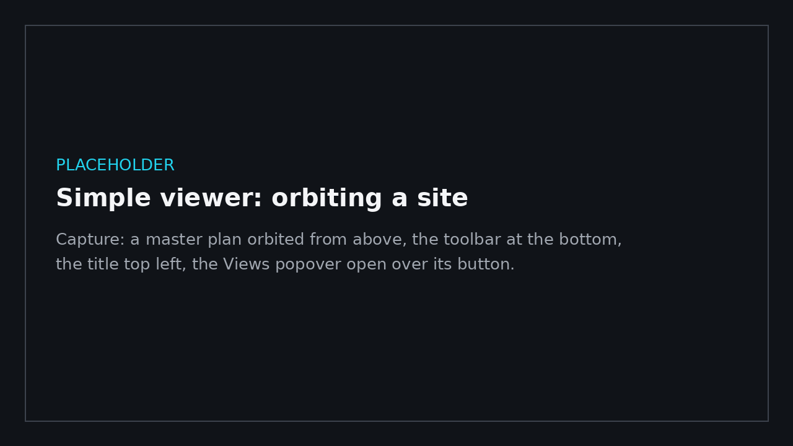

# Simple viewer

← [Docs home](README.md)

For sending a model to someone who only needs to look at it (a client, a manager): a copy of your walkthrough that
opens with a clean toolbar instead of the full set of tools and settings, and orbits like an online model viewer.

## Making a viewer copy

1. Open the model (a `.bimgo`, an IFC file, or **Go** from Revit) and set it up the way it should be seen: views
   (bookmarks), the sun, a section box, billboards, comments, [site photos](site-photos.md).
2. Optional: stand where it should open and press **Shift+H** (set home). Without a home it opens on the whole model,
   seen from the south-west.
3. Esc → **SAVE VIEWER COPY…** and pick a name. The open file isn't changed.

Send that one file. Everything it shows travels inside it, pictures included. The other person needs BimGo: the same
setup, or a portable zip with no setup at all ([Releasing → A portable zip](releasing.md#a-portable-zip-no-setup), which
can carry the viewer copy too); the copy opens in the simple viewer when they double-click it, and the first time it opens on their
PC it offers a short [tutorial](tutorial.md) (orbit, pan, zoom, walking, the toolbar, the map, home). Its menu's
TUTORIAL plays it again.

## In the viewer

| Do this | With |
|---|---|
| Orbit around what's under the cursor | drag |
| Pan | right-drag (or middle-drag, or Shift + drag) |
| Zoom toward the cursor | the mouse wheel |
| Go to a spot | double-click it |
| Walk (first person) | the walk button; then the move keys (W A S D, Shift runs, Space jumps), drag to look, double-click a floor to go there |
| Back to orbiting | the orbit button |
| Orbit ↔ walk | **V** (as in the full walkthrough): from orbiting you drop to the ground below the camera, and V again flies back up to orbit |
| Pass through walls | **G** or the toolbar's pass-through button: walking with no walls or floors in the way (the move keys go where you look, Space / Ctrl up and down); G again walks normally. From orbiting it starts there, where the camera is |
| Walk faster · slower | **=** · **-**, or the mouse wheel while walking (0.25× to 4×; the title shows it) |
| Tools | **M** measure · **X** section box · **C** comments · **B** views · **P** site photos · **Shift+P** photo browser · **O** sun (each again closes it; the toolbar's tooltips show the keys) |
| Map | **Tab** shows / hides the corner map (top right; scroll over it to zoom) · **Shift+Tab** opens / closes the site map |
| Home view | the home button or **H** |
| Save · fullscreen | **Ctrl+S** · **F11** |

The toolbar at the bottom:

- **Home**, **Orbit**, **Walk**, **Pass through walls**.
- **Measure**: click points on the model. Distance, area, angle and clearance; right-click or REMOVE LAST takes the last
  one back. Measurements are saved with the file.
- **Section box**: a box around the whole model; drag a face's handle to cut. Dragging anywhere else still orbits.
  Click the button again to close the editor (the cut stays).
- **Comments**: click the model to place a comment (text, status, priority, an optional picture with markup). Hover a
  marker to read it; ALL COMMENTS… lists them with replies.
- **Views**: the saved views (bookmarks): click one to go there, PLAY TOUR plays them in turn, SAVE THIS VIEW adds one.
  A view saved walking opens walking; one saved flying opens orbiting.
- **Site photos** (when the file has some): show or hide them, the thumbnails' size and how far they show, which group
  (building) the model shows, BROWSE FROM THE NEAREST (or BROWSE THIS GROUP ›), and the PHOTO BROWSER… (search, every
  group, grid or list). Click a floating thumbnail to look through that photo; click the photo to stay where it was
  taken, or Esc to go back. See [Site photos](site-photos.md).
- **Site map**: the whole site from above (aerial or a floor plan), the photos as small cameras, rooms' and groups' names,
  where you are (the arrow). Click a photo to look through it, double-click anywhere to go there. A **corner map**
  (top right) follows what you look at; scroll over it to zoom, click it for the site map there, or a photo on it to
  look through it.
- **Sun**: shadows on or off, the time of day and the month.
- **Fullscreen** and the **menu**: save, save as, UPDATE FROM IFC… (a newer export of the model, everything reviewed kept:
  see [Site photos → A newer model](site-photos.md#a-newer-model)), the views and comments lists, close the model.

## Sending comments back

Comments made in the viewer are saved in the file (Ctrl+S or menu → SAVE). Send the file back and open it in your
BimGo: it opens in the simple viewer too (it stays a viewer file), and menu → **Open in full BimGo** switches to every
tool. From there, Esc → **SIMPLE VIEWER** goes back. Comments also export to BCF from the full walkthrough
([Comments, markup and BCF](comments-and-bcf.md)).

## Good to know

- **Open in full BimGo** (small, at the foot of the viewer's menu) is always there: the viewer hides settings, it doesn't
  lock them.
- A viewer copy is a normal `.bimgo`: older BimGo versions open it in the full walkthrough.
- Kiosk shortcuts still open a viewer file in kiosk mode.
