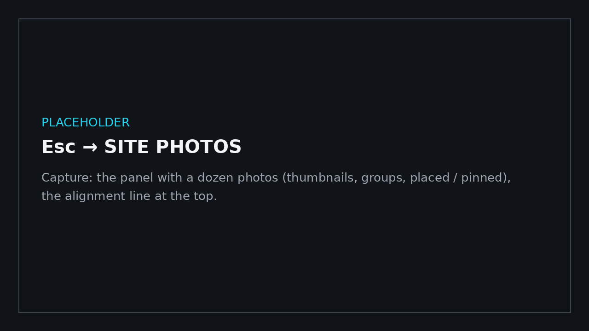
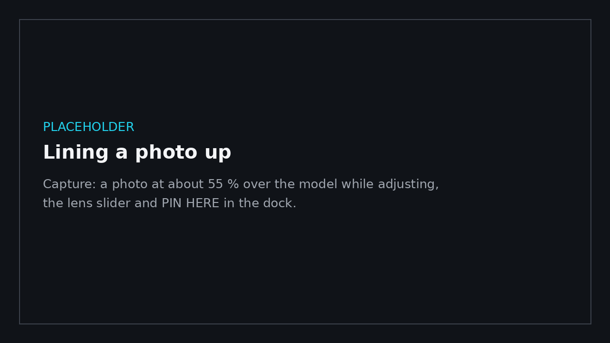
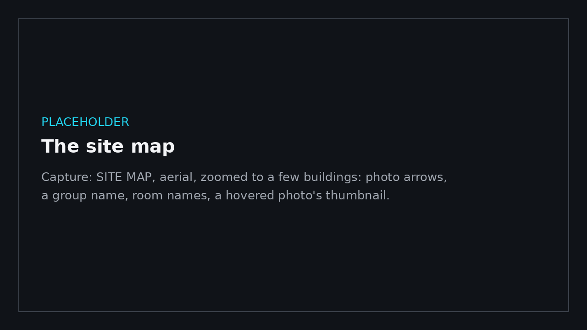

# Site photos

← [Docs home](README.md)

Photographs of the site, linked to the model: each one stands where it was taken, its thumbnail floats over the model
while you orbit or walk, and a click looks through it, the photo over the model. The photos are kept **inside the
`.bimgo`**, so whoever opens the file sees them without the originals.

## Importing

Esc → **SITE PHOTOS**:

- **IMPORT PHOTOS…** picks JPEG files; **IMPORT FOLDERS…** takes every JPEG in one or more folders (Ctrl or Shift to
  pick several) and their sub-folders. Each folder picked, or each sub-folder inside it, becomes a **group** (one per
  building, for example) with its **own colour**: its pins, thumbnails, map cameras and list rows all wear it, so
  neighbouring buildings' photos tell apart at a glance.
- Each photo is turned upright and kept at up to 2048 px (about 0.4 MB) with a small thumbnail: 100 to 500 photos add
  roughly 40 to 200 MB to the file. Photos already in the model are skipped.
- From the photo's EXIF: the **GPS position**, the **compass heading**, the lens (the 35 mm equivalent focal length, for
  the field of view) and when it was taken. HEIC photos (iPhone) need converting to JPEG first.

## Lining them up with the model

GPS says where on Earth a photo was taken; the model has its own coordinates. Pinning a photo by hand ties the two
together:

1. In SITE PHOTOS, **PLACE** (or OPEN) a photo with GPS. The photo shows over the model, see-through.
2. Fly with the move keys (Space / Ctrl up and down), right-drag to look and scroll to set the lens, until the model lines
   up with the photo (the edges of buildings, the kerbs). Use the crosshair in the middle.
3. **PIN HERE**.

With **one pin**, every other photo with GPS is placed using the model's true north. **Pin a second photo far from the
first** (across the site) to fit the turn as well; more pins average out GPS error, and the panel says how well they
agree. Photos placed from GPS stand on the first floor or ground below them, 1.6 m up, facing their compass heading.
The pins also correct the compass: phones often record magnetic north, and that offset is learnt from them.

A photo without GPS is placed the same way, by hand. **ADJUST POSITION** on any photo moves it; **UNPIN** lets it be
placed from GPS again.

## Seeing them

- **Pins**: a dot where each photo was taken with a short arrow the way it looks, and the nearest photos' thumbnails
  floating above them. **Thumbnail size** (SITE PHOTOS, or the viewer's site photos button) makes them bigger or
  smaller, and **Thumbnails show up to** hides the ones farther away (they fade out; their pins stay), so a site with
  many photos isn't cluttered from afar. Both are kept with the file, so a viewer copy shows them the way you set them.
- **SITE MAP** (**Shift+Tab** opens and closes it, in the simple viewer and the full walkthrough alike; also SITE PHOTOS
  → SITE MAP, the viewer's map button, or EXPAND on a small map): the model from straight above with every photo as a
  small camera in its group's colour (a faint wedge shows which way it looks and how wide), the groups' names and,
  zoomed in, the rooms' names; you are the arrow. **AERIAL** shows roofs and the site; **PLAN** cuts 1.2 m above a level
  (‹ › picks it) and outlines the rooms. Drag to pan, scroll to zoom, click a photo to look through it, FIT SITE shows
  everything, a double-click takes you there.
- **Small maps**: the simple viewer's corner map (top right; **Tab** hides it) follows what you look at, and the photo
  view has one too. **Scroll over a small map to zoom it** in or out; click a photo on it to look through it. The full
  walkthrough's minimap shows the photos on your level, and Shift+Tab expands it into the site map.

## Finding a building

For a site of many buildings (say 50 folders of photos):

- **PHOTO BROWSER** (SITE PHOTOS → BROWSER, the viewer's PHOTO BROWSER…, or **Shift+P** in the viewer): on the left a
  **search box** and every group in name order ("Block 2" before "Block 10"), each in its colour with its photo count;
  typing narrows the list to groups whose name matches or that hold matching photos (by name or date). Click a group to
  see its photos, as tiles (**GRID VIEW**) or rows (**LIST VIEW**); "All groups" shows every photo under a heading per
  group. For the group picked: **SHOW ON MAP** (the site map fitted on it), **BROWSE ›** (look through its photos one
  by one, ← / → stay in the group) and **ONLY THIS ON THE MODEL**.
- **Only one group on the model**: the pins and thumbnails of the other groups are hidden (they're faint on the maps),
  so one building's photos stand out. Pick it in the browser, in SITE PHOTOS ("Show on the model"), or in the simple
  viewer's site photos button ("Show on the model": a dropdown of the groups, then BROWSE THIS GROUP › and SHOW IT ON
  THE MAP). "All groups" puts everything back. It isn't saved with the file.
- **SITE PHOTOS** (the full walkthrough) has the same search, a dropdown to list one group's photos, and the "Show on
  the model" dropdown.

## Looking through a photo

Click a thumbnail (in the simple viewer, with the cursor; in the walkthrough, with the crosshair and no gun out). The
camera goes to where the photo was taken, with its lens, and the photo covers the model:

- the **mouse wheel** or the slider fades between the photo and the model;
- **‹ PREVIOUS** and **NEXT ›** step through the photos (within a group when you browse one);
- the **small map** (top right) shows where you are among the other photos: click one to go to it, scroll to zoom, or
  EXPAND (Shift+Tab) for the site map;
- **← / →** (or A / D) step to the previous / next photo too;
- **click the photo** to stay there: you stand where it was taken, looking its way, and carry on orbiting or walking
  from there;
- **CLOSE** (or Esc) takes you back to where you were before you opened the first photo.

In the simple viewer, the **site photos** button on the toolbar shows or hides the photos, sets their size and
distance, picks the group shown on the model, starts at the nearest photo and opens the photo browser. See
[Simple viewer](simple-viewer.md).

## A newer model

The model will change; the photos, comments and views made on it shouldn't be lost. Export the IFC again (same name and
folder, or anywhere) and:

- **open the `.bimgo`**: when its IFC has been saved since it was imported, BimGo asks whether to update the model from
  it;
- or **open the new IFC**: when a `.bimgo` beside it (or in the recent files) was made from that IFC, BimGo asks whether
  to update that file instead of starting a new model;
- or, any time, **UPDATE FROM IFC…** (Esc in the full walkthrough, or the simple viewer's menu): the IFC it came from,
  or another one.

The new model goes into the `.bimgo` and everything reviewed on it stays: site photos and their placement, comments,
views, measurements, the sun, billboards, camera paths, the section box and what's hidden. They're kept in the model's
own coordinates, so they stay where they were as long as the IFC is exported from the same project. Edits made in the
walkthrough (moves, demolitions) belong to the old geometry and are left out. The file is saved and opens with the new
model. Files made by this version open in later ones: what's in a `.bimgo` is only ever added to, never taken away.

## Good to know

- GPS from a phone is good to a few metres (worse between tall buildings): a photo that lands on a roof or inside a
  building can be pinned by hand.
- In a live session from Revit, the photos are kept in the model's folder (`photos.json` and `photos-images`), and a
  SAVE VIEWER COPY… takes them into the file.
