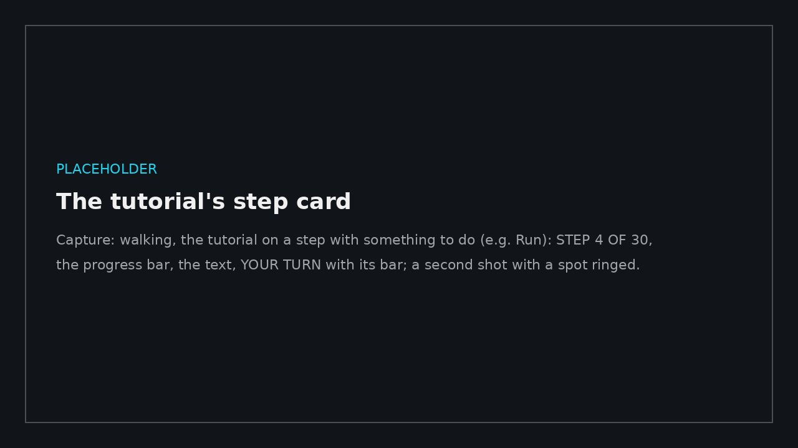
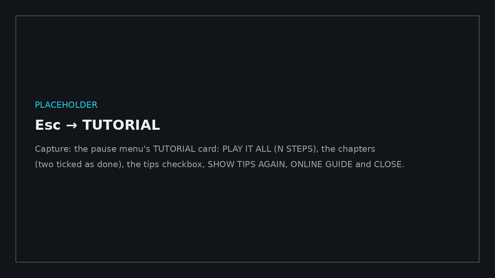

# Tutorial and tips

← [Docs home](README.md)

BimGo can show a first-time user around, one step at a time. The full walkthrough's tutorial is long: about 30 steps
in six chapters. The [simple viewer](simple-viewer.md)'s is short: about 10 steps, for someone who only looks at the
model.

## Taking it

The first walkthrough on a PC asks: **TAKE THE TUTORIAL** or **NO THANKS** (Esc). If you've used BimGo before, the
card says **NEW: THE TUTORIAL** and asks once. Either way, you can take it later from the menu.

A card at the bottom of the screen shows one step:

- **STEP 4 OF 30**, the chapter, and a bar for how far along you are.
- What the step is about, with your own keys (change a key in CONTROLS and the tutorial follows).
- Most steps ask you to do something: look around, walk, run, fly, pick a gun, open the menu, search it… **YOUR
  TURN** shows until you've done it (with a bar for walking, running and looking), then **Done**, and the next step
  follows by itself.
- **Enter** (or **NEXT** / **SKIP**) skips any step. **BACK** goes back one, and **END TUTORIAL** stops.
- The part of the screen a step is about (the gun bar, the minimap, the status, the menu's search…) is ringed.
- While you walk, the mouse is taken, so the card only shows the keys. Press Esc: the tutorial waits on the menu, where
  its buttons work.

Steps that don't fit the model are left out: changing level with one level, finding a room with no rooms, site photos
with none placed.

## The chapters

| Chapter | What it shows |
|---|---|
| Moving around | Looking, walking, running, jumping, flying through walls, levels, home |
| Tool guns | The gun bar and wheel, Scan, Measure, Comment, the other guns |
| On screen | The status, the minimap, the site map, F1 help, hiding the UI |
| The menu | Opening it, its sections, the search, INTERFACE settings, saving, a viewer copy |
| Review tools | Bookmarks, the section box, sun and shadows, finding a room, site photos |
| Pictures and video | Photo mode, the media panel, where to find help |

## Again, or one chapter

Esc → **HELP** → **TUTORIAL (N STEPS)** opens a card:

- **PLAY IT ALL**, or click a chapter to play just that one. Chapters you've finished are ticked.
- **Tips the first time I use a feature**, and **SHOW TIPS AGAIN** (below).
- **ONLINE GUIDE** opens these pages.

The simple viewer's menu has **TUTORIAL (N STEPS)**, which plays its tutorial straight away.

## In a viewer copy

A [viewer copy](simple-viewer.md) offers its short tutorial the first time it opens on a PC, so the person you send it
to sees it. So do you, the first time you open your own copy. Each SAVE VIEWER COPY… is a new copy, and offers it
again.

## Tips

The first time you use a feature (a gun, a panel, the section box, photo mode, the site map, a viewer tool…), a small
**TIP** card at the bottom left says how it works. It goes after a few seconds, or with **GOT IT**. **NO MORE TIPS**
turns them off; so does SETTINGS → INTERFACE → **Tips the first time I use a feature**. **SHOW TIPS AGAIN** (Esc →
TUTORIAL) shows each one once more. No tips show during the tutorial.

What has been seen is kept per PC in the settings ([Settings and files](settings-and-files.md)).
